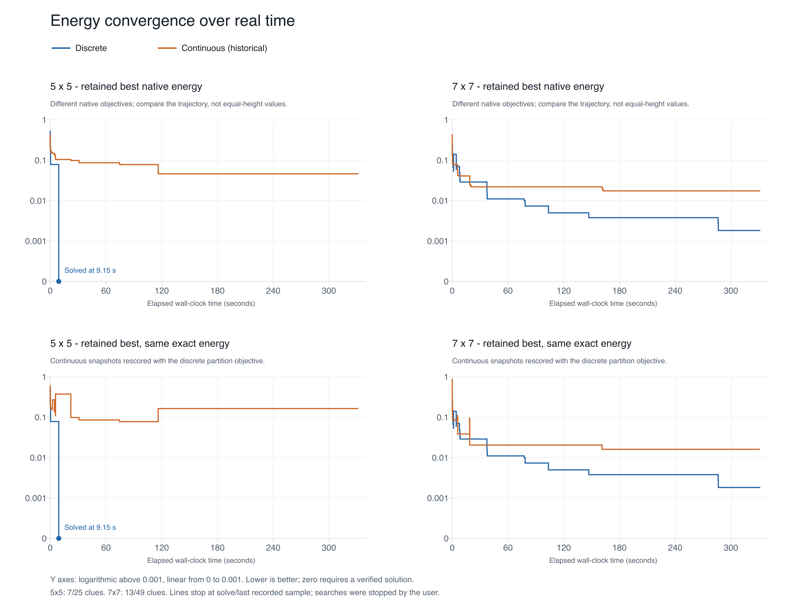
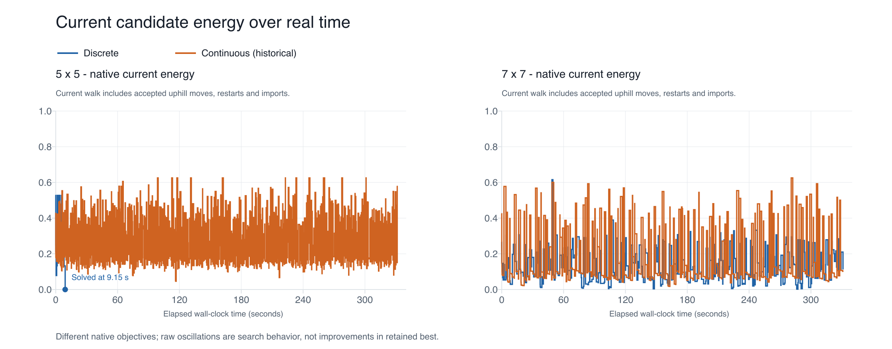

# Energy curves over real time

All searches are stopped. X axes use logged elapsed wall-clock seconds, not iterations. Only the final matched-density, uncapped runs are plotted (7/25 and 13/49 clues).

The top row shows each solver’s retained-best native total energy. Those scores have different definitions. The bottom row uses the same exact partition objective for both: normalized integer clue error weighted by 2, plus invalid-state cell fraction weighted by 1, divided by 3.25. Continuous snapshots are rescored independently. Discrete values are taken from its logged exact scorer and cross-checked where snapshots/checkpoints exist.

“Retained best” means the board kept by each algorithm’s own ranking, not the running minimum under the shared rescore. Consequently the shared-score continuous curve can increase while its own surrogate score decreases.

| Run | Last native energy | Last common exact energy | Wrong clues at that candidate | Invalid cell fraction |
|---|---:|---:|---:|---:|
| discrete5 | 0.000000 | 0.000000 | 0 | 0.000 |
| continuous5 | 0.046170 | 0.164286 | 3 | 0.440 |
| discrete7 | 0.001821 | 0.001821 | 1 | 0.000 |
| continuous7 | 0.017449 | 0.016053 | 3 | 0.000 |

Curves use recorded events, with steps between observations. Native energies are available at all logged milestones. Continuous shared energies use saved best-board snapshots (roughly every two seconds and at improvements); some final samples differ slightly in timestamp. A solved curve ends at its solution instead of being extended to the end of the other run. There is no extrapolation or fabricated completion time.

[Raw samples](energy_samples.csv) · [Series and exact-check evidence](energy_samples.json)
