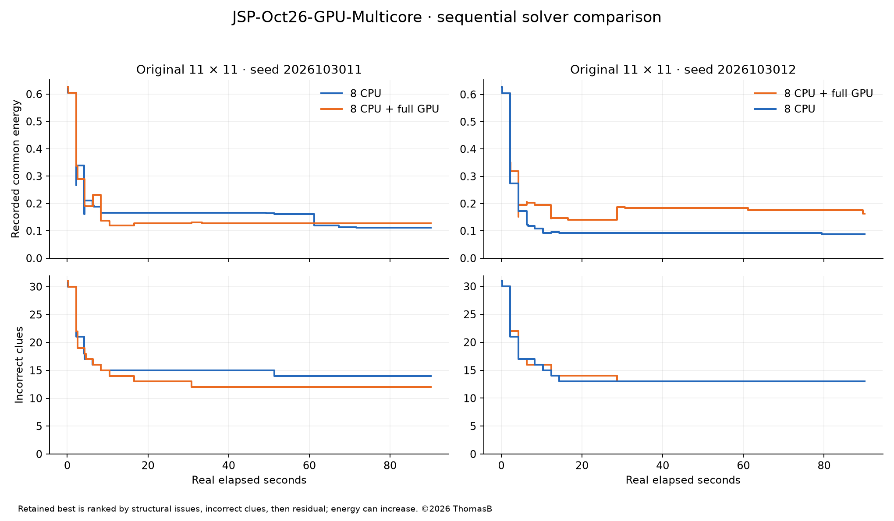

# JSP-Oct26-GPU-Multicore-Report

©2026 ThomasB

Author: ThomasB  
Date: 2026-10-30, Asia/Tokyo

## Scope

Actual production search on the M2 Mac mini: eight CPU search tasks versus the same concurrency with unrestricted use of the full 10-core GPU. Two matched seeds, CPU/GPU then GPU/CPU order, one solver process at a time, 90 seconds per configuration. Eight independent Metal queues avoid the stock singleton backend lock. No installed executable or original campaign was changed.

## Interpretation

Forced GPU path evaluation did not improve search throughput in either pair: iteration throughput fell 1.7–2.8%, while evaluation throughput fell 3.0–6.2%.

Final quality is mixed: the first GPU run has fewer wrong clues (12 versus 14); the second CPU run ties at 13 wrong clues with a substantially lower residual (0.131667 versus 0.245003). Those observations do not establish a time-to-solution gain. Retain CPU evaluation for now; this implementation offers no demonstrated overall advantage from full-GPU access.

GPU path-evaluation elapsed time summed across workers was about 28.6–28.8 seconds versus 11.3–11.5 seconds for CPU paths. Packing, submission, waits, result conversion and certification can overwhelm tiny path computations even with full-device scheduling. Most geometry/catalog work still runs on the CPU. These counters are diagnostic and overlap across workers.

## Observed results

| Seed | Mode | Seconds | CPU equivalents | Solved | Wrong clues | Residual | Iterations/s | Evaluations/s | GPU boards |
| --- | --- | ---: | ---: | --- | ---: | ---: | ---: | ---: | ---: |
| 2026103011 | cpu8 | 90.07 | 7.73 | No | 14 | 0.168391 | 185.3 | 8900.7 | 0 |
| 2026103011 | cpu8-fullGPU | 90.06 | 7.54 | No | 12 | 0.190246 | 182.2 | 8632.8 | 777498 |
| 2026103012 | cpu8-fullGPU | 90.06 | 7.56 | No | 13 | 0.245003 | 180.3 | 8626.1 | 776897 |
| 2026103012 | cpu8 | 90.06 | 7.73 | No | 13 | 0.131667 | 185.5 | 9191.8 | 0 |

All four final partitions passed the independent Python integer-rule checker. GPU results were also CPU-certified during search; no fallback was accepted. Each timed solver returned eight worker records.

Seed 2026103011: GPU/CPU iteration throughput 0.983×; evaluation throughput 0.970×. Wrong clues: 14 → 12; residual: 0.168391 → 0.190246.
Seed 2026103012: GPU/CPU iteration throughput 0.972×; evaluation throughput 0.938×. Wrong clues: 13 → 13; residual: 0.131667 → 0.245003.

Validated solves: 0/2 CPU, 0/2 GPU.
Neither configuration solved within this short cutoff. Time-to-solution improvement is therefore **not established**. Throughput and quality are screening diagnostics, not substituted solve times.

Summed per-worker path-evaluation elapsed seconds (includes GPU waiting and certification; workers overlap):

- Seed 2026103011, cpu8: 11.298 seconds.
- Seed 2026103011, cpu8-fullGPU: 28.770 seconds.
- Seed 2026103012, cpu8-fullGPU: 28.566 seconds.
- Seed 2026103012, cpu8: 11.543 seconds.
These are nested, overlapping worker timers. Do not add them to catalog/geometry times or treat them as disjoint wall-time fractions.

## Real-time curves

Curves use actual observation timestamps, including initialization and GPU setup. They retain exact-match quality leaders, so common residual energy need not decrease monotonically. Final result points use their actual final timestamps; curves are not extended to a synthetic endpoint.

## Resource use and limitations

Eight search tasks are a concurrency budget, not physical CPU pinning. This M2 has four performance and four efficiency CPU cores. CPU-equivalent cores are measured process CPU seconds divided by elapsed seconds. The GPU has ten cores; all are available to Metal, with no physical-core reservation. Each queue dispatches one threadgroup per board, up to 32 boards per batch. Neither queue count nor device availability proves full GPU saturation. Device-wide utilization samples include the GUI and any other applications. The previously installed coordinator was observed idle before this experiment and was not modified.

Seed 2026103011: 33514 GPU batches, 777498 boards, mean 23.20 boards/batch; median device-wide GPU utilization 0.0%.
Seed 2026103012: 33582 GPU batches, 776897 boards, mean 23.13 boards/batch; median device-wide GPU utilization 0.0%.

This is the existing synchronous Metal path backend with one queue per CPU worker. Geometry and final floating-point energy stay on the CPU; this is not a complete GPU energy implementation or the asynchronous frontier proposed earlier. CPU mode flushes candidate batches at size 1 while forced GPU mode uses up to 32. This changes some search work/order and means throughput differences do not isolate hardware alone. Both modes retain the same production repair/pruning logic, objectives, seed schedule and elite archive. Thread scheduling and archive exchanges make exact search trajectories nondeterministic.

The cutoff is 90 seconds, not the earlier 1,200-second campaign limit. Shader caches were warmed by excluded smoke checks, but per-process pipeline setup, serialization, waiting, certification, initialization and observation overhead remain in elapsed time. There are only two pairs and one puzzle; no statistical solve-speed or general hardware claim follows.

## Evidence

The raw `results.json`, per-worker logs/checkpoints, `observations.jsonl`, `host-samples.json`, initial `background.json`, frozen-source hashes and native binary hash are retained. Original durable data directory:

`/Users/thomasb/Library/Application Support/JaneStreetPuzzleBench/campaigns/JSP-Oct26-GPU-Multicore-20261030-194801`

The previous Repair-Completion campaign remains paused. All testing used isolated native builds, with production software version 2 recorded and core sources unchanged.
