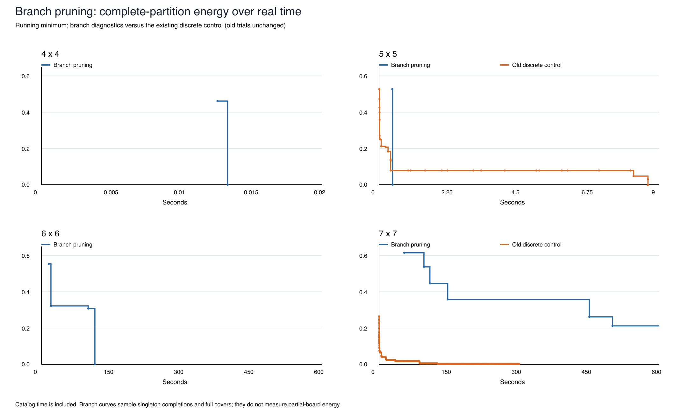
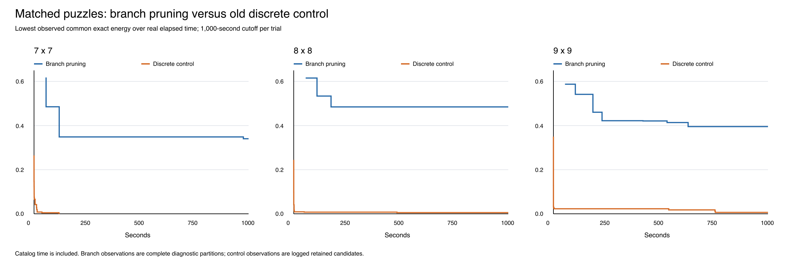

# Production-preserving regional experiment

Each trial: one worker, sequential execution, 300-second cutoff. Seeds: [20261029].

The former generic mutation harness is excluded. The production discrete control reproduced fast 5x5 solving before regional trials began. Continuous uses the historical engine with weights 2:1:2 in both arms.

| Board | Solver | Policy | Exact solve time | Incorrect clues | Structural issues | Retained exact energy | Lowest observed exact energy |
|---|---|---|---:|---:|---:|---:|---:|
| 5x5 | discrete | Control | 8.637 s | 0 | 0 | 0.000000 | 0.000000 |
| 5x5 | discrete | Regional | 10.397 s | 0 | 0 | 0.000000 | 0.000000 |
| 5x5 | continuous | Control | Unsolved at 300.000 s | 3 | 1 | 0.164286 | 0.047552 |
| 5x5 | continuous | Regional | Unsolved at 300.000 s | 4 | 0 | 0.061228 | 0.061228 |
| 7x7 | discrete | Control | Unsolved at 300.002 s | 1 | 0 | 0.003506 | 0.003506 |
| 7x7 | discrete | Regional | Unsolved at 300.002 s | 1 | 0 | 0.003787 | 0.003787 |
| 7x7 | continuous | Control | Unsolved at 300.001 s | 3 | 1 | 0.076159 | 0.035178 |
| 7x7 | continuous | Regional | Unsolved at 300.001 s | 4 | 0 | 0.037619 | 0.037619 |

Lowest observed energy is the running minimum over logged retained candidates, not every evaluated proposal. It is an observational diagnostic and does not guide either search.

Exact energy uses the same binary partition geometry and integer shortest-path distances for all candidates: `(2 * mean normalized clue error + invalid-cell fraction) / 3.25`. Native energy retains each solver's own objective; the continuous one uses stronger discreteness weights. Curves follow the solver's retained candidate, which need not minimize this common scalar score. No line is extended beyond its real stopping time.

All retained snapshots are independently checked against integer rules. Discrete exact scores are cross-checked against logged scores. Initial states are compared within each pair; see checks.json. Time-bounded production catalogs make runs timing-sensitive despite fixed seeds.

**Limits:** a one-seed pilot cannot establish a reliable speed advantage. Discrete and continuous have different initialization, move sets, ranking and temperature rules, so their difference is not caused by number representation alone. Regional changes are limited to proposal focus/breadth as documented in README.md. A cutoff is an unsolved observation, not an estimated solve time.

Search sources and their patch provenance are frozen in sources/. Original source hashes, fixtures, raw logs, independent validation, and sampled curves are preserved here. No core release or deployment occurred.

<!-- branch-pruning-extension -->

## Added experiment: Swift branch pruning, 600-second limit

Four new sequential, single-process trials only; the preceding 300-second experiments were not rerun or extended. Times below include catalog generation and search. Compilation and puzzle making are excluded. The 5×5 and 7×7 clues are exactly the old fixtures. New 4×4 and 6×6 clues use the same target density, rounded to a whole cell.

| Board | Clues | Exact solve time / outcome | Catalog generation | Catalog shapes | Nodes | Distance prunes | Final incorrect clues |
|---|---:|---|---:|---:|---:|---:|---:|
| 4×4 | 4/16 (25.00%) | Solved in 0.013 s | 0.012 s | 558 | 426 | 292 | 0 |
| 5×5 | 7/25 (28.00%) | Solved in 0.435 s | 0.406 s | 12,679 | 1,125 | 805 | 0 |
| 6×6 | 10/36 (27.78%) | Solved in 114.490 s | 15.316 s | 133,247 | 1,774,005 | 1,569,300 | 0 |
| 7×7 | 13/49 (26.53%) | Unsolved at 600.001 s (time_limit) | 45.000 s | 1,483,284 | 303,308 | 279,233 | 9 |

The sparse 5×5 solved in 0.435 s versus the previously measured 8.637 s for the discrete control (about 19.8× faster in this trial) and 10.397 s for regional discrete. The continuous arms did not solve within their old 300-second budget. This is a single trial on one fixture, not a general speed guarantee. There are no old 4×4 or 6×6 control measurements. The old 7×7 trials stopped at 300 seconds, so they do not establish what those engines would do with 600 seconds.

The new algorithm enumerates symmetric connected regions, then performs whole-board exact-cover DFS with minimum-remaining-values branching. It prunes impossible coverage, invalid capitol placements, adjacent-clue size bounds, and clue values outside admissible shortest-path bounds. Every 2,048 nodes a feasible partial cover may be completed with singletons for diagnostics and solution detection. This is a different algorithm from the annealing engines; it does not isolate number representation or regional randomization.

Catalog generation gets up to 45 seconds inside the 600-second total, with per-job quotas. Indexing and sorting happen afterward and are also included in total time; the catalog-generation column excludes that sorting. All region sizes through the entire board are allowed. Catalog status: 4×4 complete, 5×5 complete, 6×6 complete, 7×7 incomplete (67 truncated jobs). Exhausting an incomplete catalog is not an unsatisfiability proof. A timeout is not an estimated solve time.

The chart uses the same common exact energy as above, evaluated on complete partitions with valid region geometry only. The branch curve is the best observed singleton completion or full cover, while old curves retain their original sampling. No energy is assigned to an unfinished partition, and no line extends beyond its measured stopping time. Catalog generation appears as a gap before the first branch observation.

Validation: two exhaustive catalog comparisons (2×2/3×3) and six exhaustive pruning comparisons preserved all 161 satisfying small-board partitions. Every returned partition was independently checked in Python. New fixtures are generated from valid partitions; uniqueness and comparable difficulty across sizes are not established. The timed solver received clues only, without witnesses. All production source hashes remained unchanged. No release bump or deployment occurred.

Frozen Swift sources, fixtures, results, logs and validation: [../../../branch_pruning/results/20261029-160117](../../../branch_pruning/results/20261029-160117/). Algorithm and reproduction instructions: [branch_pruning/README.md](../../../branch_pruning/results/20261029-160117/../../README.md).

<!-- branch-vs-discrete-1000 -->

## Added comparison: 7×7, 8×8 and 9×9, 1,000 seconds per solver

Completed. One sequential process at a time; branch pruning first, then the frozen old discrete control for each size. Both get the same clues and a 1,000-second total solve budget. Control seed: 20261029; regional policy disabled. Earlier measurements above remain unchanged.

The 7×7 fixture is unchanged. The deterministic maker generated 8×8 (seed 8101) and 9×9 (seed 9101), sampling clues uniformly without replacement at the real puzzle’s rounded density of 33/121. The resulting puzzles are satisfiable; uniqueness and matched difficulty across sizes are not established. Witnesses are saved separately and are not passed to either timed solver.

| Board | Clues | Branch pruning | Old discrete control | Final incorrect clues (branch / control) |
|---|---:|---|---|---:|
| 7×7 | 13/49 (26.53%) | Unsolved at 1000.020 s (time_limit) | Solved in 116.734 s | 11 / 0 |
| 8×8 | 17/64 (26.56%) | Unsolved at 1000.013 s (time_limit) | Unsolved at 1000.003 s (timeLimit) | 16 / 1 |
| 9×9 | 22/81 (27.16%) | Unsolved at 1000.003 s (time_limit) | Unsolved at 1000.002 s (timeLimit) | 18 / 4 |

In this batch, branch pruning solved 0/3 puzzles and the old discrete control solved 1/3. The control solved the unchanged 7×7 in 116.734 seconds while branch pruning reached its cutoff. The earlier fast 5×5 result therefore did not generalize to this larger fixture. The control sources and seed are unchanged from the earlier pilot; time-bounded catalog generation can produce different search trajectories on reruns. A single trial cannot establish a general ranking of algorithms.

Branch pruning retains the earlier algorithm and its 45-second catalog-generation allocation inside the total budget. 7×7 uses the original 64-bit masks; 8×8 and 9×9 use 128-bit masks to represent all 64/81 cells correctly. The search heuristics and pruning rules are unchanged. The control is rebuilt from the frozen sources of the prior production-preserving experiment, with its original configuration and moves. Both are optimized Swift builds; compilation and fixture generation are outside the timer. Catalog generation, indexing and search are inside the branch timer. Wrapper process-wall times are also saved.

| Branch board | Catalog generation | Catalog shapes | Catalog complete? | Search nodes | Distance prunes | Final exact energy |
|---|---:|---:|---|---:|---:|---:|
| 7×7 | 45.001 s | 1,466,963 | No | 458,111 | 418,416 | 0.340276 |
| 8×8 | 45.002 s | 1,666,430 | No | 204,454 | 177,914 | 0.484529 |
| 9×9 | 45.002 s | 1,472,061 | No | 241,853 | 193,656 | 0.395321 |

Energy is the same common exact score used above, plotted against actual elapsed seconds. Branch observations come from full covers and singleton completions; control observations come from retained-candidate logs. Their sampling differs, and energy alone is not solve speed. Curves start at the first observation and stop at the measured ending time. A truncated branch catalog is incomplete; a cutoff does not prove impossibility or estimate eventual solve time. This is one fixture and one trial per solver per size, with fixed branch-first order and no machine-load isolation.

The 64-bit build repeats eight exhaustive checks. The 128-bit build repeats those checks and adds solved all-singleton 8×8/9×9 cases, verifying bits through cell 80. All reported final partitions are independently validated for geometry, capitols and integer clue distances; all logged control snapshots are independently checked too.

All production source hashes remained unchanged. No installed executables, live state or deployment were touched.

Artifacts: [fixtures, frozen sources, logs, results, validation and sampled energies](../../../branch_vs_discrete/results/20261029-162908/).
