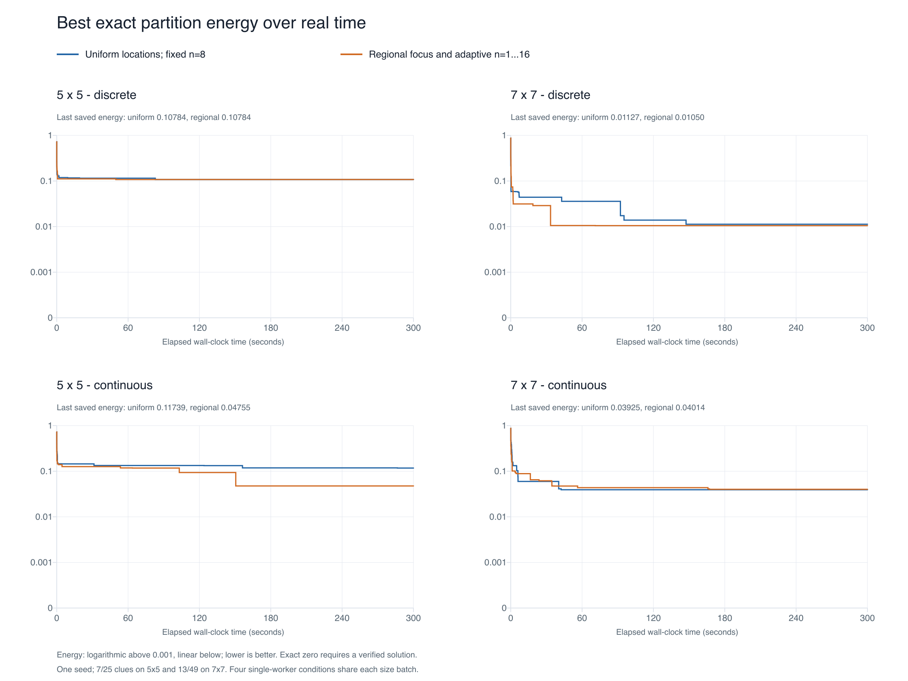

# Regional energy pilot results

Completed observations: 8/8. One matched search seed (20261029); 300-second cutoff per condition.

This is the shared experimental mutation harness described in the plan. It is not the complete production catalog/repair solver, so its times are not directly comparable with the earlier production benchmark. The primary contrast is regional versus uniform within each representation.

| Condition | Outcome | Verified solve time (s) | Last best exact energy | Wrong clues | Structural issues |
|---|---|---:|---:|---:|---:|
| 5x5-discrete-uniform | Unsolved at 300s cutoff | — | 0.107839 | 4 | 0 |
| 5x5-discrete-regional | Unsolved at 300s cutoff | — | 0.107839 | 4 | 0 |
| 5x5-continuous-uniform | Unsolved at 300s cutoff | — | 0.117386 | 4 | 0 |
| 5x5-continuous-regional | Unsolved at 300s cutoff | — | 0.047552 | 3 | 0 |
| 7x7-discrete-uniform | Unsolved at 300s cutoff | — | 0.011271 | 2 | 0 |
| 7x7-discrete-regional | Unsolved at 300s cutoff | — | 0.010500 | 2 | 0 |
| 7x7-continuous-uniform | Unsolved at 300s cutoff | — | 0.039249 | 5 | 0 |
| 7x7-continuous-regional | Unsolved at 300s cutoff | — | 0.040140 | 4 | 0 |

## Within-representation energy comparison

| Board / representation | Uniform best exact energy | Regional best exact energy | Regional change |
|---|---:|---:|---:|
| 5x5 discrete | 0.107839 | 0.107839 | 0.0% unchanged |
| 5x5 continuous | 0.117386 | 0.047552 | 59.5% lower |
| 7x7 discrete | 0.011271 | 0.010500 | 6.8% lower |
| 7x7 continuous | 0.039249 | 0.040140 | 2.3% higher |

No solve-time winner is established if both trials hit the cutoff. Lower best exact energy measures progress, not faster solving. The regional policy changes both focus and breadth; this pilot does not isolate spatial assignment from a change in overall mutation aggressiveness.

## Proposal diagnostics

| Condition | Mean n | Mean changed edges / attempt | No-ops | Accepted / evaluated proposals | CPU seconds |
|---|---:|---:|---:|---:|---:|
| 5x5-discrete-uniform | 8.00 | 2.525 | 7.2% | 4.8% | 295.10 |
| 5x5-discrete-regional | 7.42 | 2.893 | 8.4% | 4.6% | 295.12 |
| 5x5-continuous-uniform | 8.00 | 1.575 | 0.9% | 37.7% | 295.11 |
| 5x5-continuous-regional | 7.35 | 2.163 | 0.8% | 33.5% | 295.11 |
| 7x7-discrete-uniform | 8.00 | 3.585 | 8.4% | 10.6% | 288.07 |
| 7x7-discrete-regional | 8.10 | 4.226 | 8.7% | 9.5% | 288.06 |
| 7x7-continuous-uniform | 8.00 | 2.522 | 0.5% | 43.2% | 288.03 |
| 7x7-continuous-regional | 7.66 | 3.352 | 0.4% | 40.1% | 287.99 |

## Energy and fairness

Both arms compute the field and rescore the whole board. Uniform uses random focus and n=8. Regional uses 20% uniform exploration, 80% energy-weighted focus and n=1...16. Both continuous arms use weights (AIM, symmetry, discreteness)=(2,1,2); binary uncertainty is zero. Native discrete energy is normalized over its two active terms.

The shared exact energy is (2*normalized integer clue error + invalid-state cell fraction)/3.25. “Best exact” is the smallest value encountered, saved for observation only. It does not change acceptance or proposal generation. Native-best and current traces are provided separately, so a low surrogate score is not confused with an exact solution.

Each size batch starts its four one-worker conditions together. Completed solves may free CPU capacity for survivors; process CPU times are shown. Compilation is excluded, while initialization, field computation, proposals, scoring, validation, checkpoints and logging are inside search wall time. There is no GPU path evaluation.

Cutoffs are right-censored observations, not 300-second solve times. This one-seed pilot does not establish a typical solve time or a general speedup. If neither member of a pair solves, compare progress curves and exact residuals without claiming a solve-time winner.

[Native retained-best curves](native-energy.png) · [Current-state curves](current-energy.png) · [Raw samples](energy_samples.csv) · [Build metadata](metadata.json) · [Full results](results.json)

Verified: all conditions of a size share the initial topology; ON/OFF pairs have identical initial relationship values. Final snapshots were independently checked by the Python rules checker.
