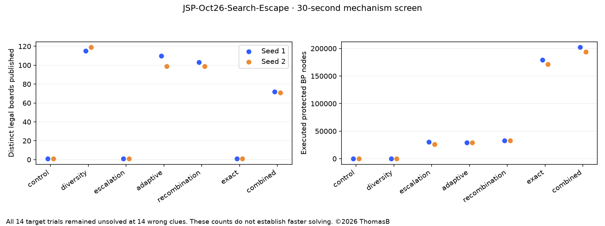

# JSP-Oct26-Search-Escape-Report

©2026 ThomasB

**2026-10-31 follow-up:** The subsequent long campaign stopped after 12.24 hours
without improving its starting 13-error board. See the
[stall investigation and corrective screen](../20261031-stall/JSP-Oct26-Search-Escape-Stall-Report.md).
It identifies a necessary 26-cell region bound that the small-patch CP-SAT lane
could not satisfy from its incumbent. The historical screening data below remain
unchanged; the long run does not establish a solve-speed benefit.

Author: ThomasB

Generated 2026-10-30T23:30:44.399180+09:00. This report precedes live integration.

**No original-puzzle solve occurred in the 14 Swift screening trials. All retained 14 wrong clues and residual 0.17078227.** The mechanisms changed measurable behavior, while CP-SAT independently improved residual to 0.16036970 in one small neighborhood. No solve-time superiority is established.

## Local Swift screen

Original 11×11, same archived incumbent, four cooperating CPU threads, two matched seeds, 30 seconds per policy. Trial order reverses in the second block. The control is the new harness using the legacy persistent-BP scheduler and best-only exchange, not a rerun of the original production architecture. Probe clocks are accelerated to 3/8/16 seconds; live settings are 60/180/600. No discoveries cross policies. All final partitions and worker partitions passed independent Python validation.

| Policy | Distinct legal boards published, seeds 1 / 2 | Protected BP nodes, seeds 1 / 2 | Wrong clues, both |
| --- | ---: | ---: | ---: |
| control | 1 / 1 | 0 / 0 | 14 |
| diversity | 115 / 119 | 0 / 0 | 14 |
| escalation | 1 / 1 | 30309 / 26049 | 14 |
| adaptive | 110 / 99 | 28974 / 28957 | 14 |
| recombination | 103 / 99 | 32755 / 32683 | 14 |
| exact | 1 / 1 | 179178 / 171432 | 14 |
| combined | 72 / 71 | 202226 / 193751 | 14 |

Distinct published boards count canonical legal partitions observed by the archive, including candidates not retained. Active walks were already distinct in the control; the diversity change expands sharing and working-basin choices. Protected-node counts are executed work, not completion percentages. The combined trial includes one exact-feasibility lane. Candidate states differ between policies after initialization by design.

Both escalation probes created full-board protected jobs and scopes of at least 32 cells. Diversity runs performed 8–9 migrations. Adaptive/recombination runs actually exercised different scope kinds, but 30 seconds is insufficient to rank all operators. Most adaptive time initially goes to neighbor/full-board work. These are composite experimental policies, not a complete factorial study.

CPU use ranged from 3.77 to 3.98 equivalents. Local build/tests and the one-thread CP-SAT probes briefly overlapped this short screen; throughput and hardware timing must not be treated as controlled speed comparisons. The original Mini run stayed active throughout. Timing includes loading and checkpoint I/O. Raw inputs, outputs, counters, binary hash and source snapshot accompany this report.

## Independent constraint approach

- On the same generated 4×4 fixture, native exact BP solved in 0.040 s; CP-SAT solved in 0.369 s including 0.268 s to generate all 1130 legal shapes. One small case validates functionality, not a general speed ranking. No uniqueness claim.
- Eight original-puzzle neighborhoods of 12–16 cells used exhaustive local shape domains with the exterior fixed. Best: 14 wrong clues, residual 0.16036970, in 0.280 s including preparation. All returned labels and shortest distances were independently checked. This improves residual by 6.10%, with no reduction in wrong clues.
- A whole-board restricted domain of 7932 shapes ran for 20.03 s and returned FEASIBLE, 14 wrong clues with unchanged residual. The domain uses rectangles and transformed incumbent regions and is incomplete; no original-puzzle infeasibility conclusion follows.
- CP-SAT minimizes wrong-clue count followed by absolute distance error. The retained Swift objective uses normalized residual as its secondary criterion. Candidate acceptance uses independent original-quality evaluation; the differing secondary objective is explicit.
- Model constraints enforce exact-cover symmetric regions, capital rules, integer state sizes, positive edge weights and Bellman equalities for shortest distances. Path inequalities alone are not used as an exact-distance substitute.

## Decisions backed by this screen

1. Integrate canonical alternative sharing and separate working-basin references: observed diversity and migrations increased without losing the incumbent. This is a mechanism result, not proof of faster solving.
2. Integrate explicit scope growth, protected CPU service, compatible stack restoration and exhausted-scope memoization. The broad searches received real nodes; default full-board work is bounded rather than assigned to every worker.
3. Keep adaptive operators/recombination enabled in an experimental portfolio with telemetry and exploration. Their solve benefit remains unproven; do not replace all neighbor repairs or privilege routes.
4. Reserve one Mini thread for persistent exact feasibility, while retaining heuristic workers. Native small-case solving passed, but the target did not solve in the short screen.
5. Run CP-SAT as an optional one-core local sidecar performing exact small-neighborhood repair, with occasional restricted full-board search. It is the only screened approach to produce a better retained target candidate. Exchange only validated puzzle-matched states.

## Next implementation and validation

Add protected stack recovery across segments, pool-wide stagnation clocks, current/retained energy and diversity telemetry, compatible checkpoint checks and an independent local CP-SAT sidecar. Preserve the stopped v5 run and its final/checkpoint data before a version-6 standalone restart. The live target is a solve attempt, not another short timing comparison. No fan controls or installed production executable are changed.

References: [Large Neighborhood Search](https://backend.orbit.dtu.dk/ws/files/5293785/Pisinger.pdf), [official CP-SAT guide](https://developers.google.com/optimization/cp/cp_solver).

## Subsequent integration checks

The released implementation's local eight-thread two-segment (six seconds each)
check, seeded with the independently improved CP-SAT board, found a 13-wrong-clue
partition (residual 0.17027197863745597) and preserved it through segment handoff.
All worker partitions passed the independent validator. Three repair jobs were
restored, including the exact lane. Stagnation clocks carried forward. This is
a post-screen integration check with different thread count, inherited CP-SAT
discovery and initial stagnation age; it is not another matched treatment trial
or evidence of a solve-speed ratio. The improved board is carried to the Mini
solve attempt. The original 14-trial screening data remain unchanged.

All 16 shared Swift tests and the five then-current escape-policy tests passed locally; the final regression addition brings the policy suite to six. Release-6
preflight passed strict/current, older rejection, explicit legacy transition and
future rejection. The Mini uses native builds and process probes, not XCTest.

## Live confirmation and archive performance correction

The version-6 live Mini portfolio exercised all five operators: at 368 seconds,
91 block, 103 capital, 152 disagreement, 83 neighbor and 66 route slices were
recorded, alongside 364 full-board slices. These are executed slices, not unique
global improvements. The local CP-SAT companion improved the retained 13-clue
board's residual to 0.16496219632232606.

Live resource accounting prompted an archive-retention component experiment.
The same greedy diversity selection can maintain incremental nearest distances
and reuse the fixed grid edges rather than recomputing all distances under the
shared lock. Twenty shuffled candidate sets selected identical entries. In 100
varied timed cases with consumed output checksums, the old selector took 1.2848 s
and the incremental selector 0.002477 s (about 519× for this component). The
recorded 17 legal-board dataset and Swift benchmark accompany the report. **This
is not a whole-solver or time-to-solution speedup.**

Release 7 applies this equivalent calculation, retains release-6 search policies,
and carries compatible repair stacks and separate record/wrong-clue clocks into
a fresh durable campaign. Strict native result version checks become 7; older
results are only accepted as explicitly validated offline seed/checkpoint data.
The version-6 run, its source and all original screening artifacts stay separate.

The integration check also caught a final-sample edge case: a last-moment new
record could leave the progress snapshot stale. Every new record now flushes
immediately, and a regression test verifies the wrong-clue clock resets even
inside the one-second regular reporting interval. Six new policy tests and all
16 shared tests passed.

## Final deployment verification

Release 7 resumed the eight-thread Mini solve attempt with 29 compatible repair
jobs restored from release 6. At 94 seconds it showed 7.74 CPU-equivalent cores,
eight observed workers, 551 distinct legal boards published, 16 retained archive
boards and three migrations. This is descriptive live telemetry, not a controlled
whole-solver speed comparison. The best board still has 13 wrong clues, no
structural issues and residual 0.16496219632232606. The one-core local CP-SAT
companion is running; its previous completed candidate logs remain preserved.

The strict release-7 native preflight and restoration evidence accompany this
report. The full execution record is [JSP-Oct26-Search-Escape-Run](../../JSP-Oct26-Search-Escape-Run.md).
[Live dashboard](http://127.0.0.1:60793/). Cooling and installed production
executables remain unchanged. The original puzzle has not been solved.
