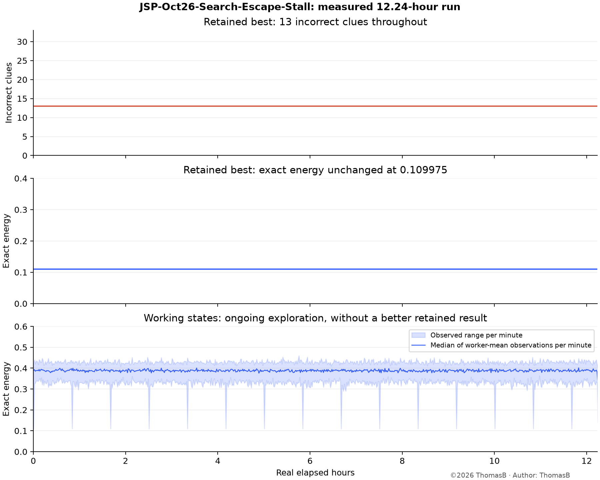

# JSP-Oct26-Search-Escape-Stall-Report

©2026 ThomasB

Author: ThomasB · 2026-10-31 · Asia/Tokyo

**The run failed to improve its starting result in 12.24 hours. It is now
cooperatively stopped, with results and branch checkpoints preserved.** This was
an ineffective search, not a crashed worker or a chart hiding a solution.
Independent validation still finds 13 incorrect clues, zero structural issues,
and residual 0.16496219632232606. Zero structural issues means that the regions
obey the geometry rules; it does not mean that the puzzle is solved.

## What the long run actually accomplished

| Measurement | Recorded value |
| --- | ---: |
| Wall time through final controller snapshot | 44,047.86 s / 12.24 h |
| Segments | 14 complete; 15th cooperatively interrupted |
| Summed native process CPU time | 93.13 core-hours |
| Improved retained results | **0** |
| Incorrect clues, start and end | **13 → 13** |
| Common exact energy, start and end | **0.10997479754821737 → unchanged** |
| Annealing iterations | 10,409,157 |
| Restart events | 51,885 |
| Explicit BP nodes | 43,078,814 |
| New repair jobs / evicted repair jobs | 14,997 / 14,997 |
| Exhausted repair domains during this run | **0** |
| Local CP-SAT attempts / published improvements | **7,159 / 0** |

The CPU total excludes the separate local CP-SAT process. Native work counters
sum the last recorded worker observations for each segment. The final result of
each segment has the same retained quality. Stagnation clocks inherited earlier
work and therefore exceed this campaign's elapsed time.

The working-state graph measures exploration, not progress toward completion.
Its periodic downward spikes include segment startup/final publication of saved
best states. They do not establish discoveries. The plot above preserves actual
retained observations and aggregates working observations into one-minute
medians and observed ranges for readability. No completion percentage is inferred.

## A structural limitation that should have been checked first

In the original puzzle, **77 at row 11, column 9** is three orthogonal moves from
**0 at row 11, column 6**. In any solution the latter cell is a capital. If the
largest region has size M, every edge costs at most M, so the straight route
costs at most 3M. The shortest route to any capital costs no more than that:

`77 ≤ cost of this three-edge route ≤ 3M`, hence **M ≥ 26**.

This follows from the printed clues and travel rules; it does not use a planted
solution. More generally, two clue distances differ by at most the cost of any
path between them. For clues separated by L Manhattan steps, a necessary bound
is `largest region ≥ ceil(abs(clueA − clueB) / L)`.

The retained candidate's largest region has **14 cells**. The small CP-SAT lane
replaces whole regions inside a patch of at most **16 cells**, keeping the exterior
fixed. From this candidate its domain therefore contains no region larger than
16. **Such a domain cannot contain a complete solution of this puzzle.** Small
repairs can still improve partial scores, but repeating them is not a complete
solve strategy. This is a limitation of that lane and incumbent, not a proof that
the whole puzzle is infeasible. The 223 restricted whole-board CP-SAT attempts
and the native large-scope/exact lanes could represent larger regions.

There are additional useful necessary conditions:

- Adjacent clues 77 and 61 require both cells' region sizes to be at least 16:
  their distance difference cannot exceed their connecting edge's cost. Both
  currently lie in a 14-cell region.
- A clue 1 must neighbor a singleton capital. A positive-clue cell cannot itself
  be a singleton, because a singleton is a capital and has distance zero.
- A printed zero must be a capital in a complete solution.

The new reusable `clue_constraints.py` derives the pairwise area bound,
adjacent-cell size bounds, and singleton-capital disjunctions. CP-SAT outputs
now record these deductions, the largest candidate/fixed region available in
the domain, whether the area bound excludes a complete solution, and the exact
patch/base identity. These are necessary-condition diagnostics; passing them
does not certify feasibility. They do not silently impose hard restrictions on
the existing soft repair objective.

The retained candidate actually computes **31 instead of 77**, and **41 instead
of 61**. All 13 mismatches are listed in [clue-audit.json](clue-audit.json).

## Why the other lanes also stalled

**Repair frontier churn.** The old scheduler inserted a new job every four BP
calls and evicted the oldest unprotected job when four slots were occupied.
Restoration preserved trees across segment boundaries, but did not protect them
from replacement within a segment. At shutdown, ordinary jobs typically had
zero to four slices of work. All newly created jobs were offset by evictions;
none reached domain exhaustion during the run. Escalation also made nearly every
new ordinary scope about 64–75 cells, making those short lifetimes especially
inadequate.

**Search state churn.** Every 200 iterations without a personal record, the old
annealing engine generated a fresh random board. Across the seven annealing
workers this averaged roughly one random restart per worker every six seconds.
Island workers also discarded their island reference at those restarts. This
undermined sustained work around promising boards and imported alternatives.

**Exact search remains enormous.** The protected exact lane did preserve its
tree. At the final checkpoint it had cumulatively visited 17,758,743 nodes,
performed 17,536,784 distance prunes, and completed zero covers. Its current
stack held three selected regions and four frames. Shape generation is lazy,
interleaved with search; it was not waiting at a stopped preliminary catalog
stage. These node counts are work, not an estimate of distance to a solution.
Changing frontier lifetime alone cannot remove this combinatorial difficulty.

**Scoring remains an open issue.** Annealing's native objective emphasizes
normalized residual, while the archive ranks incorrect-clue count before
residual. Improving one objective need not improve the other. The corrections
below do not change that scoring rule, so their effects can be distinguished
from a future scoring experiment.

## Corrections implemented and tested locally

The isolated release-8 candidate adds opt-in anchored restarts to the shared
engine. Repair workers return to their retained best; island workers return to
their island best. The independent worker retains fresh random restarts in the
eight-worker portfolio. Existing shared-engine callers retain the old default.

The experimental scheduler now fairly services unfinished jobs and gives each
ordinary job at least **60 seconds of accumulated search work** before it may be
evicted. Protected searches remain protected. Completed jobs may be replaced
immediately. It mixes target sizes 16/32/64, growing by whole regions, rather than
escalating every ordinary scope to 64 cells. Operator rewards avoid repeatedly
crediting the same personal improvement, and the counter is accurately named
`workerImprovements` instead of suggesting a pool-wide record.

The elapsed-work checkpoint field is optional. Old checkpoints decode without
it and receive a new work allowance; saved search trees and policy signatures
remain compatible. No wire framing changed.

### Short paired target screen

Four sequential local trials used the same original 11×11 incumbent, four CPU
threads, two paired random seeds, 60 seconds per trial, and real 60/180/600-second
scope clocks with inherited stagnation age 44,000 seconds. The second seed
reversed treatment order. `stabilized=false` selects the legacy scheduling and
restart behavior in the same binary. No discoveries cross trials.

| Policy | Incorrect clues, seeds 1 / 2 | Exhausted domains, seeds 1 / 2 | Mean sampled working energy, seeds 1 / 2 |
| --- | ---: | ---: | ---: |
| Legacy behavior | 13 / 13 | 0 / 0 | 0.33972 / 0.35117 |
| Anchored + sustained mixed scopes | 13 / 13 | 3 / 4 | 0.29192 / 0.28785 |

**Both policies retained exactly the starting residual and energy. No solve or
retained improvement occurred.** The correction changes working behavior and
allows some small scopes to finish; it has not demonstrated faster solving.
The energy averages describe published worker-mean samples after five seconds,
not a completion measure. Restart counters still count re-anchoring events in
the corrected mode and cannot be interpreted as fresh-random-restart counts.

The local test/build work briefly overlapped the first two trials. CPU use was
3.92–3.98 equivalents; throughput is not a controlled speed comparison. These
trials have four workers, rather than the full eight-worker role mix, and do not
run long enough to test every repair's 60-second service guarantee. Results are
mechanism evidence, not a statistical ranking or an eight-core Mini benchmark.

### Focused retention check

A separate component probe held the incumbent fixed and performed 120 work
slices of up to 20 ms, using the same seed and cached shape templates. It removes
annealing between slices to exercise eviction quickly. It is not a solver-time
benchmark.

| Measurement | Legacy | Corrected |
| --- | ---: | ---: |
| Jobs created | 31 | 6 |
| Jobs evicted | 27 | 0 |
| Domains exhausted | 0 | 2 |
| Surviving jobs' service slices | 4, 2, 1, 0 | 26, 25, 25, 25 |

This verifies that work now accumulates instead of repeatedly discarding the
frontier. The combined changes are not individually ablated by this probe.

## Decision and next approach

**Keep the long campaign stopped. Do not deploy or restart an indefinite
release-8 campaign on these results.** The bookkeeping/scheduling corrections are
useful, but the short experiments did not improve the target result.

The next meaningful algorithm experiment should search for globally plausible
large-region structures while respecting deductions from the clues. In
particular, it must represent regions of at least 26 cells, release enough
neighboring regions to create them, and explore alternative capital layouts.
Small exhaustive repairs can polish those structures afterward. The existing
13-error candidate should remain an incumbent, rather than dictate every new
search's structural scale.

For the exact lane, test clue-driven branch ordering and propagation before
enumerating large unconstrained shape domains. For the heuristic lane, test a
feasibility-first or staged constraint objective against the present residual
objective. Necessary constraints must be enforced soundly in a feasibility
search; a partial-score lane must clearly label them as violations if it allows
them to be relaxed. Validate pruning on exhaustively solved small boards, then
run bounded matched target trials. Evaluate actual clue agreement and verified
solutions before authorizing a further long continuation.

This evidence does not establish that SA or BP cannot solve the puzzle. It
establishes that this portfolio and incumbent failed over the recorded budget,
and identifies a domain restriction that excluded every full solution from the
small-patch CP-SAT lane.

## Verification and preserved evidence

- Seven Swift policy tests and all 16 shared Swift tests passed. Tests include
  old checkpoint decoding, protected search restoration, expired-slice retention,
  fair service, and preservation of a retained best through worse migrations.
- Four Python deduction tests passed, including exhaustive checking of every
  legal 2×2 partition with a capital against its derived exact clue field.
- The complete-domain 4×4 CP-SAT smoke test solved and independently validated;
  an original-board patch returned the unchanged incumbent and correctly
  reported `solutionExcludedByAreaBound=true`.
- Release authority is now 8. Isolated native preflight passed strict/current
  acceptance, rejection of older peers, explicit minimum-0 legacy acceptance,
  and rejection of future peers. Installed production binaries were untouched.
- Both the Mini solver and local CP-SAT companion stopped. The read-only
  dashboard remains available. No fan, cooling, power or credential changes were
  made. No live SQLite file was replaced or synchronized through iCloud.

Evidence: [long-run audit](JSP-Oct26-Search-Escape-Stall-Audit.json),
[paired trials](swift-screen/summary.json), [clue deductions](clue-audit.json),
[CP-SAT target check](cpsat-target-check.json), [release preflight](authority-preflight.json),
and frozen source/raw trial artifacts in this directory. The audit records the
remote campaign path, local mirror path and final snapshot SHA-256. Original
long-run raw observations and exact trees remain at the stopped campaign;
the compact report export does not replace them.
