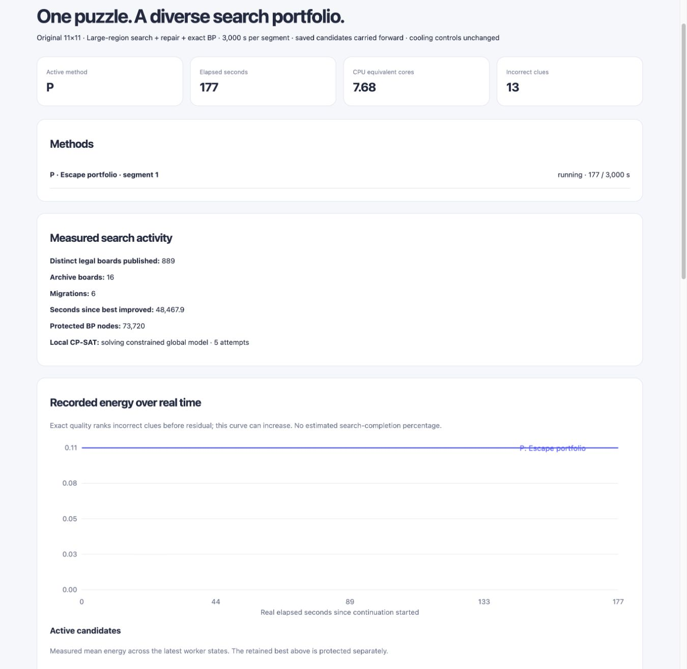

# JSP-Oct26-Structural-Search-Report

©2026 ThomasB

Author: ThomasB · 2026-10-31 · Asia/Tokyo

The new approach searches large symmetric regions and capital layouts before
polishing local errors. **No original-puzzle solve or improvement of the retained
13-error incumbent is established by the checks in this report.** It has found
a separate 14-error board satisfying all implemented necessary constraints.
These are different measures; neither establishes distance to a solution.

## Implementation

Four Mini workers use a new Swift structural strategy, alongside two incumbent
repair workers, one broad repair worker, and the preserved exact-feasibility
search. All eight cooperate on one original 11×11 puzzle. An optional companion
uses one local CPU core for constrained whole-board CP-SAT. No GPU or fan-control
changes are involved.

- `ClueDeductions.swift` compiles pairwise distance/area bounds, adjacent-cell
  minimum sizes, printed-zero capitals, forbidden positive-clue capitals, and
  the singleton-capital requirement for clues of one.
- `StructuralRegions.swift` grows symmetry orbits directly into large connected
  shapes. It can add or remove whole orbits from existing regions. Each proposed
  region is checked against the full geometry/capital definition. It does not
  enumerate all smaller shapes before attempting a 26-cell region.
- Whole existing regions touched by a replacement, and regions violating local
  deductions, are released together. Bounded randomized branching retiles their
  complement using all rectangles, cached small templates, current regions, and
  generated large shapes. The proposal catalog is incomplete: failed tiling
  attempts are never reported as proofs of infeasibility.
- `StructuralStrategy.swift` maintains an independent working objective:
  `4 × necessary-constraint penalty + (wrong clues + residual) / clue count`.
  This provides gradients for missing area and shape conditions. Annealing may
  temporarily relax global necessary conditions; telemetry reports violations.
  Per-shape catalog conditions prune invalid candidates. A zero penalty is
  necessary, not sufficient, for a solution.
- The original exact quality ordering still protects every worker's retained
  best. Structural workers can explore a worse original score without erasing
  the 13-error incumbent. Their best structural states have separate checkpoints
  and survive segment handoff. The generic engine's strategy hook defaults to
  absent, preserving existing callers' behavior.
- The companion now solves restricted **whole-board** models. It adds native
  large-region shapes and imposes the derived necessary constraints as hard
  conditions. It uses exact-cover variables and exact Bellman shortest-distance
  equations. Small 16-cell patches no longer dominate its work. Restricted
  domain optimality/infeasibility never proves global optimality/infeasibility.
- A separate structural exchange carries constraint-feasible discoveries back
  to native workers. Puzzle identity, geometry and original quality are checked
  independently before publication/import; only genuine original-quality
  improvements update the retained global-best channel.

The required large-region bound is 26: clue 77 is three moves from a printed
zero, so `77 ≤ 3 × largest region size`. This is derived from the clues, not from
a planted partition. Candidate construction changes no puzzle clues.

## Quick evidence before continuation

An isolated eight-thread local functional run lasted 75 seconds. Its four
structural workers retained largest regions of **36, 37, 39 and 60 cells**, each
with zero implemented necessary-constraint violations. Their working boards
had 22, 21, 23 and 24 incorrect clues respectively. All eight final retained
partitions passed the independent Python validator; the global incumbent stayed
at 13 wrong clues and residual 0.16496219632232606.

A one-thread whole-board CP-SAT check used 8,698 candidate shapes, including
these new regions. In a 20-second solve/preparation budget, it improved the
constraint-feasible working board from **21 to 16 wrong clues**. This seeded the
first Mini continuation. During that short live continuation, the companion
found a **14-error constraint-feasible board**, which is carried forward. Its
original residual is 0.23897808626367287, so it does not replace the retained
13-error board.

These checks validate mechanisms and candidate quality. They are not matched
time-to-solution comparisons. Local compilation/tests briefly overlapped the
75-second run; local CPU throughput is not compared with Mini throughput.

## Live correction before the final restart

Release 9 exposed a Mini performance problem: after the dynamic shape bank
filled, successful tiling proposals stopped increasing for an observed interval.
The tiler eagerly rechecked every dynamic shape before entering its bounded
branch search. Release 10 instead validates only eligible dynamic shapes and
caches those checks within an attempt. Candidate geometry/constraint tests are
unchanged; full partition validation remains in place.

A sequential one-thread Mini component check used the same puzzle, 256 generated
large shapes and twenty trivial one-cell tilings with a 40 ms deadline each:

| Component check | Release 9 | Release 10 |
| --- | ---: | ---: |
| Completed calls | 20 / 20 | 20 / 20 |
| Branch nodes | 20 | 20 |
| Identical expected partitions | Yes | Yes |
| Total wall seconds | 0.161312 | 0.000784 |

This confirms a large reduction in repeated setup overhead. **Both idle component
checks met their deadlines.** It does not itself establish that deadline misses
caused every live tiling failure, nor a whole-solver speedup. Live proposal/node
counters are checked again after the corrected restart.

The brief release-9 campaign was stopped cooperatively. Its new discoveries,
source, raw observations and checkpoints remain intact. Release numbers are
monotonic: the final continuation uses **10**, not a replacement executable
masquerading as release 9.

## Validation and recovery

All **11 Swift policy/structural tests**, **16 shared Swift tests**, and **five
Python deduction/model tests** passed. They cover the printed solved example,
direct large-region generation, finite-cover validity, independent structural
checkpoint recovery/mismatch rejection, old repair checkpoint compatibility,
retained-best preservation, and preservation of known solutions under the new
necessary constraints. Exhaustive 2×2 partition checks are included.

The Mini's release-9 native recovery probe restored all **29 branch jobs** and
**four structural states**. Its exact frontier advanced from 17,758,743 to
17,762,672 cumulative nodes. All worker results were independently validated.
Release 10 repeats native recovery before the final restart.

Both native release preflights check default minimum=current, current acceptance,
older rejection, explicit minimum-0 legacy acceptance, and future rejection.
Wire framing and credentials are unchanged. Builds use isolated scratch products;
installed production executables are untouched. Only closed JSON/source data and
the existing frozen shape seed are copied; no live solver SQLite database is
replaced or synchronized through iCloud.

## Execution policy

The requested continuation uses **one Mini puzzle process with eight CPU
workers**, in **two sequential segments of up to 3,000 seconds** each. A verified
solve stops it early. The initial queue therefore has a 6,000-second solver
budget instead of running unchanged indefinitely. Full repair trees, structural
working states and the original-quality incumbent carry across segments.

The read-only dashboard at <http://127.0.0.1:60793/> shows retained-best energy,
actual working-state energy, CPU accounting and separate structural diagnostics.
Zero necessary violations is explicitly labeled as insufficient for solving.
The lower worker table's wrong-clue count is the protected retained result; the
structural table shows the separate working result.

See [the run record](../../JSP-Oct26-Structural-Search-Run.md) for the final live
paths, release, PIDs and verification snapshot. Immutable smoke data, source
archives, preflight outputs and logs accompany this report. No solve-time
superiority or uniqueness claim is made.

## Final live verification

Release **10** resumed at **2026-10-31T13:13:58.443670+09:00**, with native recovery and minimum-peer
checks passed. At the 112.3-second observation, the process used **7.69 CPU
equivalents**. Worker tiling counts increased from 3,784/3,689/3,757/3,824 to
6,620/6,645/6,684/6,770 between two real snapshots. Corresponding tiling branch
counts also increased, verifying ongoing work beyond the earlier filled-bank
plateau. Each best structural board had a 26-cell largest region, zero necessary
violations and 14 wrong clues. The protected original-quality incumbent remains
at 13 wrong clues.

The release-10 native probe restored 29 repair jobs and four structural states;
its exact tree advanced from 17,853,448 to
17,857,012 nodes. These are work and recovery
checks, not estimated completion percentages.

Evidence: [first live sample](live-validation-first.json),
[second live sample](live-validation-second.json),
[health summary](live-health-summary.json),
[native preflight/recovery/component checks](native-final-preflight-and-checks.json),
[14-error structural seed](structural-seed-14.json), and
[launch record](launch.json). Source archives distinguish release 9 from release
10. The read-only browser was reloaded and the actual running dashboard verified.

