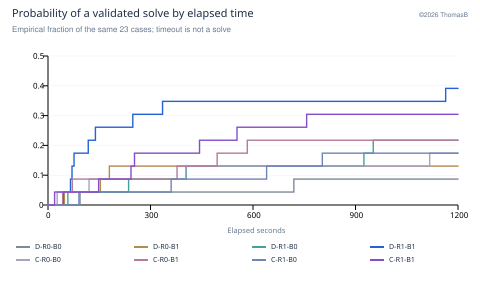
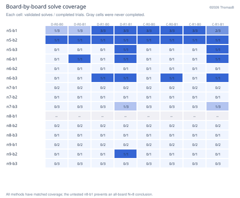
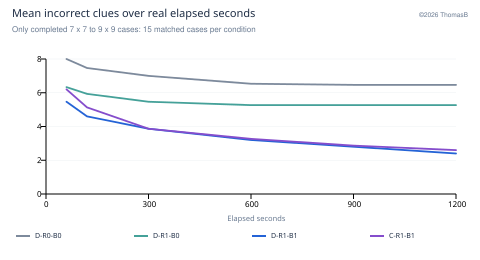
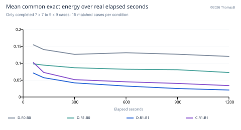
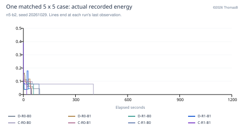
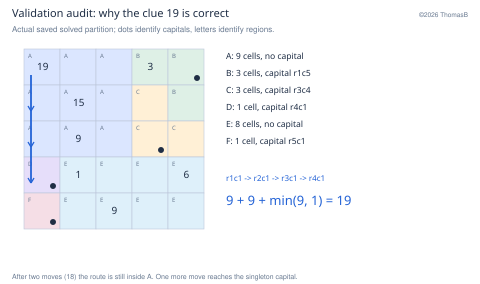

# JSP-Oct26-Regional-SA-BP-Final-Report
©2026 ThomasB

Stopped 2026-10-30 at 12:07 JST.

## Regional search + branch pruning is the leading direction

Stopped at user request on 30 October 2026, 12:07 JST. Campaign 20261029-214421. The experiment is stopped early, not completed: 184 of 360 trials finished, with 39 validated solves and 145 timeouts. No workers remain active. The queue retains 176 uncompleted jobs; 172 never started and four have only an interrupted final attempt.

Decision: use discrete regional SA + new BP as the experimental baseline, keep continuous regional + BP as a challenger, and focus development on completing larger puzzles. The results support a search family, not a claim of a reliable fresh-start 11 x 11 solver or superiority over current production.

| Condition | Solved / 23 | Rate | Capped time |
|---|---|---|---|
| D-R0-B0 | 2/23 | 8.7% | 1,131.0 s |
| D-R0-B1 | 3/23 | 13.0% | 1,060.0 s |
| D-R1-B0 | 5/23 | 21.7% | 1,051.1 s |
| D-R1-B1 | 9/23 | 39.1% | 828.7 s |
| C-R0-B0 | 4/23 | 17.4% | 1,063.8 s |
| C-R0-B1 | 5/23 | 21.7% | 1,007.4 s |
| C-R1-B0 | 4/23 | 17.4% | 1,073.6 s |
| C-R1-B1 | 7/23 | 30.4% | 939.9 s |

D/C = discrete/continuous; R0/R1 = regional off/on; B0/B1 = new BP phases off/on. Every row faced the same 23 board/seed cases. Capped time is mean observed solve time, with an unsolved full trial counted as 1,200 seconds. It is not predicted eventual solve time.

### What is established

Regional search and new BP each improve outcomes in matched comparisons. D-R1-B1 leads with 9/23 solves and 828.7 s capped cost; C-R1-B1 reaches 7/23 and 939.9 s. Across all settings, however, continuous solves 20/92 and discrete 19/92, so representation alone remains unsettled.

The main limitation is scale: only 3 of 120 completed trials at N=7 to 9 solved. All 184 final partitions are structurally valid, so those failures are clue-distance failures. Three generated fixtures are now definitely non-unique, including the sole successful N=9 board. The user-questioned 19 clue is correct: 9 + 9 + 1; the capital is outside the 9-cell square.

## What was measured, and what stopped early

The shared Swift framework tests all eight combinations of representation, regional policy and extra BP phases. There are three fixed boards for each N=5,6,7,8,9 and three matched seeds per board: 20261029, 20261030 and 20261031. Clue counts are 7, 10, 13, 17 and 22, matching round(N*N*33/121). Each search receives one synchronous CPU thread, no GPU, and a 1,200-second wall-clock cap. Four searches run concurrently.

The initial preparation policy required one to three proven partitions per board. At the user's request it was amended to use the current puzzles without waiting for uniqueness. Every fixture has an independently checked saved solution, but saved solutions were never passed to timed workers. Only the three N=5 boards retain proven unique counts.

| Size | Completed | Solved | Full matched blocks |
|---|---|---|---|
| 5 x 5 | 40 | 29 | 5 / 9 |
| 6 x 6 | 24 | 7 | 3 / 9 |
| 7 x 7 | 48 | 2 | 6 / 9 |
| 8 x 8 | 24 | 0 | 3 / 9 |
| 9 x 9 | 48 | 1 | 6 / 9 |

There are 23 complete eight-condition blocks across 14 distinct boards. Every completed trial is in a complete block, so the primary comparison has no incomplete-condition imbalance. n8-b1 has no completed trial; the study cannot make an all-three-board N=8 claim. Some boards have three completed seeds, others one or two.

The queue was explicitly paused and resumed once, then stopped for this report. Eight interrupted attempts are excluded from solve-rate and capped-cost denominators. The first four interrupted jobs were rerun as fresh attempts and eventually timed out; the final four remain uncompleted. Their observed effort is preserved separately. An interrupted run is neither a 1,200-second timeout nor an eventual solve.

### Data integrity checks

A separate Python integer-rule implementation rechecked all 184 final candidates, including connectivity, all grid symmetries, capital definitions, shortest-path distances, clue mismatches and answers. All results agree with the recorded Swift outcomes. All 15 known fixture solutions passed. The eight-condition initial quality/native energy was identical, with zero initial discreteness, in all 23 matched blocks. Worker binaries and the permanent shape database still match their recorded SHA-256 hashes. No infrastructure-failed trial exists.

## Matched effects support regional search and extra BP

Solve events are absorbing outcomes. Timeouts remain unsolved through the cap; this is not extrapolation of an energy curve.

| Paired change | Pairs | Cost difference | Exploratory 95% interval |
|---|---|---|---|
| Continuous - discrete | 92 | 3.5 s | [-49.0, 60.7] s |
| Regional on - off | 92 | -92.2 s | [-169.1, -31.9] s |
| New BP on - off | 92 | -120.9 s | [-226.4, -43.3] s |
| D hybrid - C hybrid | 23 | -111.1 s | [-230.5, -18.6] s |

Negative cost difference favors the first named change. Intervals use 10,000 board-cluster bootstrap resamples, retaining all observed seeds and condition comparisons within each sampled board. There are only 14 observed board clusters. These are descriptive sensitivity intervals, not multiplicity-adjusted confirmatory tests or a random sample of all puzzles.

Regional-on solves 25/92 versus 14/92 off: 12 pairs add a solve and one loses a solve. New-BP-on solves 24/92 versus 15/92 off: 10 pairs add a solve and one loses one. Representation has six continuous-only solves versus five discrete-only solves. D versus C within regional BP has only four discordant solve pairs (three D-only, one C-only), so its solve-rate distinction is fragile despite the capped-cost lead.

Regional benefit in capped cost is larger with BP than without it: the matched difference-of-differences is -114.4 s. This is consistent with complementary roles, but does not isolate a mechanism. Equal-board weighting also retains the D-hybrid lead; it is a sensitivity check on the same evidence, not another independent experiment.

## Difficulty varies sharply by board

The same board and seed coverage is available to every condition. Each entry is solves / valid completed attempts.

N=5 has 29/40 solves, N=6 has 7/24, N=7 has 2/48, N=8 has 0/24, and N=9 has 1/48. These size totals mix conditions and repeat seeds, so they describe this workload rather than a population-level scaling law. The provisional D-hybrid solves 1/6 at N=7, 0/3 at N=8 and 1/6 at N=9.

Board effects are substantial even at N=5: n5-b2 was solved by every method in its one completed seed block; n5-b3 was solved only by the two regional+BP methods in its one completed block. The three N=5 boards have different known structures despite identical clue counts.

The clue-density rule alone does not match the original puzzle's distribution of regions, capitals or difficulty. The planted N=9 witnesses have largest regions of only 11-13 cells, although some bounding boxes exceed the seed-cache area of 16. Failure therefore cannot be explained solely by absence of very large planted regions. Conversely, the one N=9 solve occurs on a board whose planted witness has a 24-cell bounding box, so an incomplete materialized seed cache is not automatically a barrier to every solve.

## Late improvement is real, but is not a solved puzzle

Budget summaries use the last actual sample at or before each time. A validated earlier solve contributes known zero error afterward.

Common exact energy excludes the representation-dependent discreteness term. Individual energy traces can rise when wrong-clue count improves.

Among unsolved N=7-9 trials, 38/57 with BP improved exact quality after 600 seconds versus 19/60 without BP. Median last observed improvement was 859.2 s with BP and 418.0 s without it. Only 31 of all 39 successes arrived by 600 s; four more arrived by 900 s and four afterward. The sole N=9 solve took 1,163.9 s. Shortening the cap would discard observed successes, even though most large-board runs still fail.

## What the BP and resource counters do - and do not - show

This example uses actual timestamps and all recorded energy observations, with no extension of a stopped curve to 1,200 seconds.

| Measured quantity | Value |
|---|---|
| Completed search CPU effort | 51.48 core-hours |
| Completed search wall effort (sum over workers) | 52.11 worker-hours |
| Interrupted sampled CPU effort | 1.02 core-hours |
| Aggregate CPU / wall | 98.8% |
| Per-trial CPU / wall range | 86.5% to 100.0% |
| Peak observed per-worker memory | 167.9 MiB |
| New BP phases / source improvements | 12,207 / 2,955 |
| New BP nodes | 36,245,156 |
| New BP wall share in B1 trials | 4.0% |

A nominal one-second BP allowance does not mean a full second is consumed. Actual BP totals 59.4 minutes across 24.51 B1 worker-hours. The source-improvement counter can improve the current state without improving the global incumbent. Global gain per CPU second is not logged directly. Catalog, ordinary cover and BP times overlap; do not add them.

The CPU counters are consistent with one hot search thread per process. macOS P-core pinning is not guaranteed, and other activity/thermal conditions are uncontrolled. The resource totals exclude preparation, queue/dashboard overhead and report generation. Iteration throughput is not the solve-speed metric. Increasing every BP allowance is a hypothesis to test, not a measured fix.

## The 19 clue: an explicit rule audit

Saved candidate n5-b2-continuous-r0-b0-s20261029; solved at 403.521 s, with answer 5,445.

The 9-cell blue 3 x 3 region has no capital. Its rotations fix its center, but each reflection fixes three cells. The rule requires every nontrivial symmetry to fix exactly one square, so the center does not qualify. The 8-cell rectangle also has no capital. The other four regions have capitals marked by dots above.

The shortest route from the top-left 19 cell is r1c1 -> r2c1 -> r3c1 -> r4c1. Two moves inside the 9-cell region cost 9 each. After those moves, at cost 18, the traveler is still in that region. The third move enters the singleton capital and costs min(9,1)=1. Thus the clue is 19, not 18. Independent multi-source Dijkstra confirms this is the minimum over all four capitals, not merely the cost of one available route.

| Clue cell | Printed distance | Independently calculated |
|---|---|---|
| r1c1 | 19 | 19 |
| r1c4 | 3 | 3 |
| r2c2 | 15 | 15 |
| r3c2 | 9 | 9 |
| r4c2 | 1 | 1 |
| r4c5 | 6 | 6 |
| r5c3 | 9 | 9 |

The dashboard previously showed region colors and clues without marking capitals. That visualization makes this rule easy to misread; colors can also repeat when there are more than ten regions. The evaluator uses actual labels, not colors. Report diagrams explicitly mark capitals and region identities. A capital overlay is a useful UI improvement, independent of the solver comparison.

## Unknown uniqueness and limits on the conclusions

| Board | Distinct solved partitions seen | Distinct valid answers seen |
|---|---|---|
| n5-b1 | 1 | 13,013 |
| n5-b2 | 1 | 5,445 |
| n5-b3 | 1 | 1,813 |
| n6-b1 | 1 | 28,602 |
| n6-b3 | 4 | 2,880, 2,984, 3,080, 3,642 |
| n7-b3 | 2 | 11,219, 13,841 |
| n9-b2 | 1 | 13,653 |

All three 5 x 5 fixtures have independently checked solutions and exhaustive unique-partition certificates. Exact counts remain unknown for the other twelve fixtures. The experiment itself proves timed-search lower bounds for two of them: n6-b3 has at least four distinct valid partitions and four answers (2,880; 2,984; 3,080; 3,642), while n7-b3 has at least two (11,219; 13,841). Adding the independently validated planted witnesses raises the known lower bounds to five partitions/answers for n6-b3 (also 4,040), and three for n7-b3 (also 14,237). n9-b2 also has at least two known partitions and answers: the timed solve gives 13,653 while its validated planted witness gives 26,821. All three N=7-9 timed successes differ from their planted witnesses. These are genuine clue-compatible solutions, not invalid successes; their full solution sets are still uncounted.

This matters for the original goal: a solver that succeeds on an underconstrained generated board may have found an alternative state layout, while the real puzzle may demand a specific unique layout. The original few-solution objective was waived before trials. The result remains a matched heuristic comparison on these fixed clues, but the large-board successes all came from demonstrably ambiguous fixtures and provide weaker evidence for performance on a unique real puzzle. A later held-out study should control this property where feasible without spending the entire budget proving uniqueness.

### Other interpretation limits

Continuous and discrete arms differ in perturbation behavior and a continuous-only discreteness penalty, not just storage type. Regional-on bundles focus selection with perturbation width. B0 already contains ordinary bounded branching repairs; B1 adds a whole intensification policy, so it does not isolate the pruning bound alone. Finite time slices and discovery order make theoretical full shape-domain coverage different from completed enumeration. The frozen experiment is not today's richer production search. No fresh 11 x 11 solve was tested in this campaign.

Stopping was informed by interim results. The reported best condition is selected after inspecting eight arms, and repeats of the same boards do not replace independent held-out puzzles. Fixed-seed trials can still diverge with wall-clock timing. Bootstrap intervals, ranking and subgroup findings are exploratory. An energy decrease is neither a certificate of closeness to a unique partition nor an estimate of remaining solve time.

## Recommended next step and reproducibility

### A focused completion experiment

1. Freeze this dataset. Do not silently pool future solver versions or warm-start trials into these results. The current experiment is stopped; no new search has been started for this report. Retain D-R1-B1 as the frozen experimental baseline and C-R1-B1 as a challenger.

2. Diagnose productive repair before increasing its allowance. Log patch size, fixed exterior compatibility, full exhaustion versus time slicing, discovery work and global incumbent gain per CPU second. Compare one coherent repair change at a time: persistence of compatible prefixes, targeted patches along persistently wrong-clue routes, or adaptive size/budget. The existing four-percent BP share and late gains justify this investigation, but do not identify the best change.

3. Test scale and the actual goal early. Use matched fresh seeds on N=7-9, including the previously untested n8-b1. Add fresh-start 11 x 11 pilot trials and a resource-controlled comparison with current production. Production already has richer archives, growth, deductions and objective rotation. Keep any solver-produced warm-start finishing diagnostic separate from end-to-end solve time. Verified solution fixtures may support offline rule/reachability checks, never timed initialization or cache prewarming.

4. Prespecify the decision. Keep the 1,200-second cap for comparability and late successes. Primary endpoints are validated solve fraction and capped solve cost. Track common energy, wrong clues and useful repairs as explanatory metrics. Set a finite budget and held-out validation boards before launching. Do not infer the 11 x 11 solve rate from these N=5-9 observations.

### Reproducible evidence package

The accompanying folder contains the immutable final snapshot, all 184 completed trial rows, eight interrupted-attempt records, fixed-budget energy observations, actual timestamped curves, every fixture and validation record, paired/cluster-bootstrap summaries and source scripts. The bootstrap seed is 20261030 with 10,000 board-level resamples. Individual curves stop at their last actual sample; aggregate solve fractions use observed event times.

All final candidates and known fixture solutions passed the independent checker. Binary and shape-store hashes match the campaign manifest. Full hashes are recorded in audit.json. The original queue and SQLite database remain in Application Support outside iCloud and were not replaced. The stopped dashboard can still inspect historical data. Source code and raw data paths are local; the offline HTML report and PDF require no running server.

Rebuild the analysis with python analyze.py snapshot.json OUTPUT (the snapshot folder includes portable observation fallbacks); then use the bundled Python runtime to run build_report.py after placing the analysis files beside it. The report is a terminal snapshot at 12:07 JST and supersedes the interim 11:31 assessment.

## Frozen board inputs - appendix 1

Clues are unchanged across all eight conditions and all matched seeds. Saved witnesses were withheld from timed workers.

A unique label means an exhaustive certificate already existed before timed search. "Exact count unknown" is not a claim of uniqueness. Observed multiple solutions are detailed in the preceding analysis.

## Frozen board inputs - appendix 2

Clues are unchanged across all eight conditions and all matched seeds. Saved witnesses were withheld from timed workers.

A unique label means an exhaustive certificate already existed before timed search. "Exact count unknown" is not a claim of uniqueness. Observed multiple solutions are detailed in the preceding analysis.
